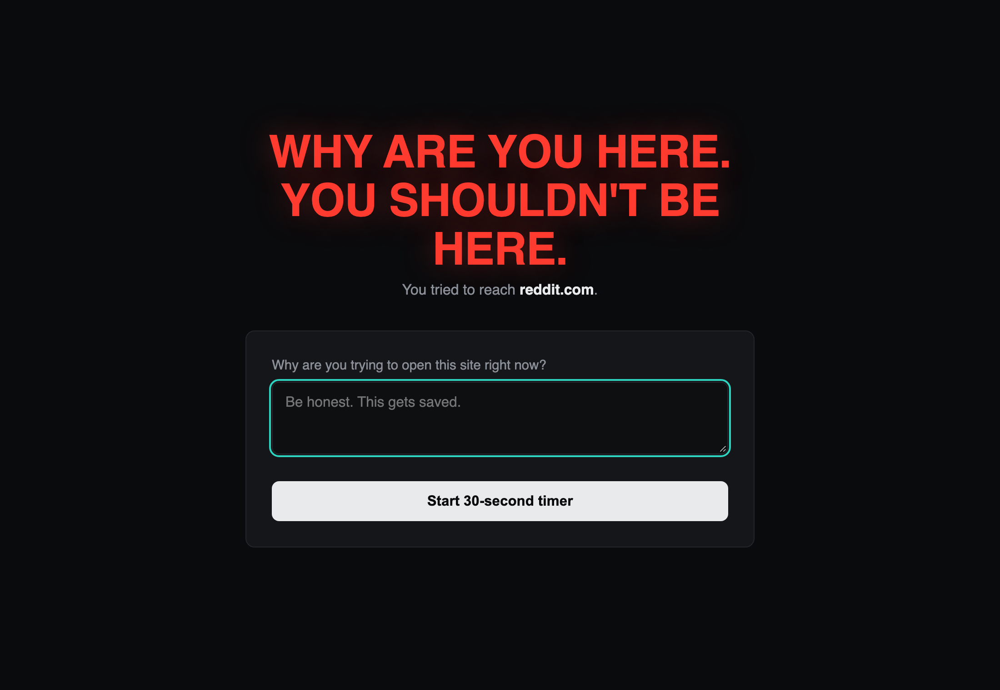
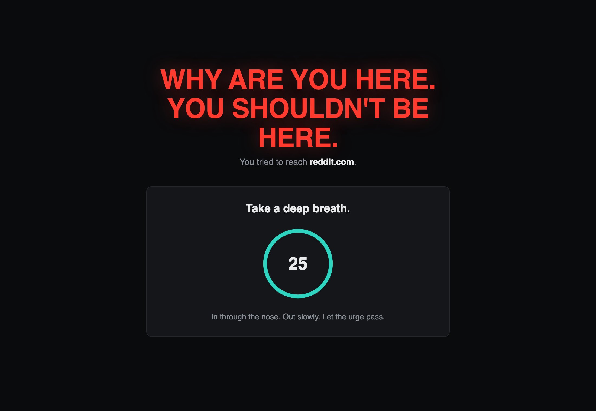
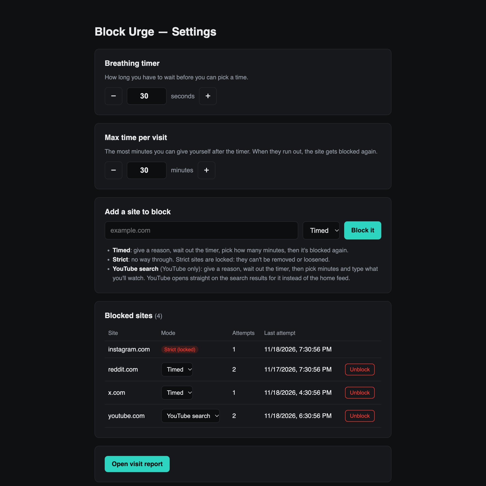
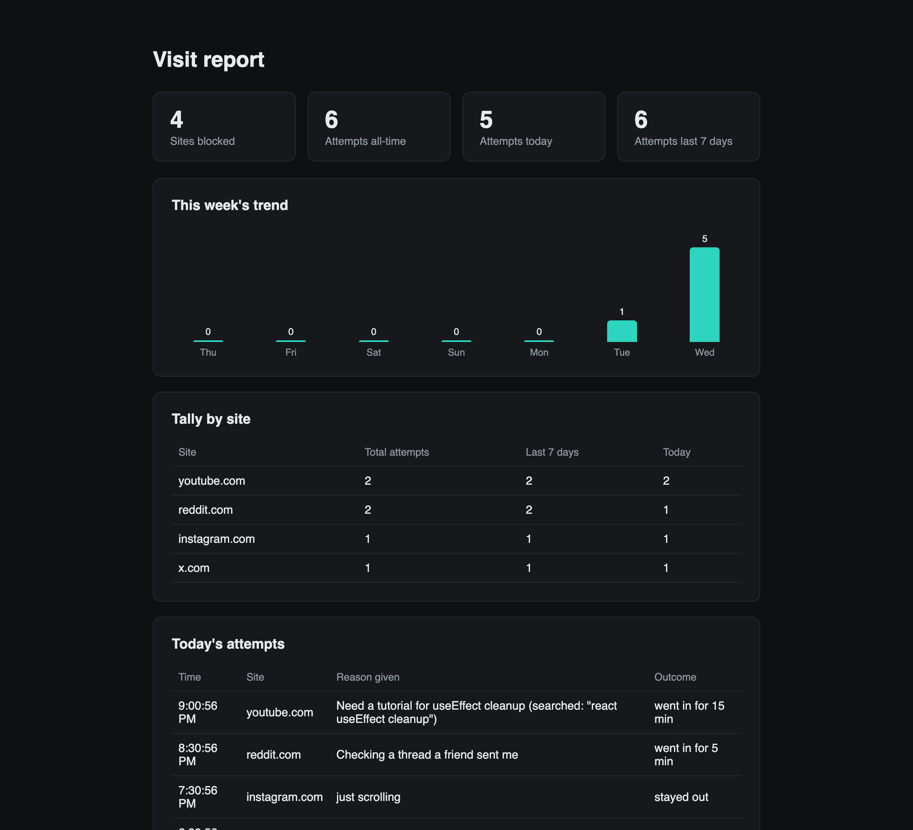

# Block Urge

**[Install from Firefox Add-ons](https://addons.mozilla.org/en-GB/firefox/addon/block-urge/)** · [Website](https://sangameeee.github.io/Block-Urge---website-blocker/)

A Firefox extension that makes impulsively visiting a site much harder. When
you open a blocked site it asks why you're there, makes you wait out a
breathing timer, and then (depending on the site's mode) lets you in for a
number of minutes you choose. When the time is up, the site is blocked again.

## Screenshots

| Say why you're there | Breathe through the timer |
| --- | --- |
|  |  |


| Settings | Visit report |
| --- | --- |
|  |  |

## Modes (set per site)

| Mode | What happens when you open the site |
| --- | --- |
| **Timed** | Give a reason, wait out the timer, pick how many minutes you need, then you get access. When the time runs out, every tab on that site is sent back to the block page. |
| **YouTube search** (YouTube only) | Give a reason, wait out the timer, then pick minutes **and** type what you're going to watch. YouTube opens straight on the search results for it, skipping the home feed. Blocked again when the time is up. |
| **Strict** | No way through. Your reason is still logged. Strict sites are locked: they can't be removed or switched to another mode. |

## Settings

- **Breathing timer**: 5 to 600 seconds, adjusted with − / + (steps of 5) or by typing a value.
- **Max time per visit**: the most minutes you can give yourself after the timer (1 to 240).
- **Blocked sites**: add a site with its mode, change the mode of non-strict sites, or unblock them (type `UNBLOCK` to confirm).
- **Toolbar popup**: block the current site in one click (Timed / Strict / YouTube search). While a pass is active, it shows the time left and an "I'm done, block it now" button.

## Details

- Blocking is host-based: blocking `reddit.com` also blocks `www.reddit.com`, `old.reddit.com`, etc.
- The breathing timer pauses when you switch away from its tab.
- A pass covers the whole site (all tabs) until it expires. Expiry uses
  `alarms`, and passes that expired while the browser was closed are cleaned up on startup.
- Every attempt is logged locally: time, reason, YouTube search, and whether you went in and for how long. See the report page (popup → View report).
- All data stays in `storage.local`. There's no server, account, or sync.

## Try it locally

1. Go to `about:debugging#/runtime/this-firefox`.
2. Click **Load Temporary Add-on…** and select `src/manifest.json`.

## Package for the stores

```bash
sh no_zip/build.sh
```

This creates `no_zip/dist/block-urge-firefox-<version>.zip` and `block-urge-chrome-<version>.zip`. The Chrome build gets a generated manifest that uses a service worker and drops the Firefox-only keys. Step-by-step publishing guides are in `no_zip/publish_firefox.md` and `no_zip/publish_chrome.md`.

## File map

```
src/                   — the extension itself (everything that goes in the zip)
  manifest.json        — extension manifest (Firefox MV3; Chrome's is generated)
  background.js        — navigation watcher, timed passes, messaging
  storage.js           — shared data layer (all pages use this)
  blocked.html/.css/.js — block page: reason → timer → minutes (+ YouTube search)
  popup.html/.css/.js  — toolbar popup
  options.html/.css/.js — settings
  report.html/.css/.js — daily/weekly report
  icons/               — toolbar icons
screenshots/           — images used in this README and on the website
index.html             — GitHub Pages landing page
no_zip/                — build script, publishing guides, built zips (never packaged)
```
